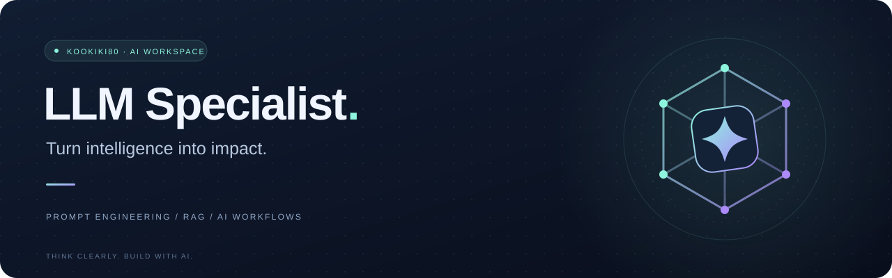

### AI를 이해하고, 가능성을 실용적인 결과로.

**LLM 전문가 · 생성형 AI · AI 기반 문제 해결**

기술을 나열하기보다, AI로 무엇을 더 쉽고 유용하게 만들 수 있는지 고민합니다.

---

## 👋 About me

안녕하세요. **LLM과 생성형 AI를 활용해 아이디어를 실제 도구로 연결하는 kookiki80**입니다.

- 🧠 **명확한 문제 정의** — 도구를 고르기 전에, 해결할 문제와 기대하는 결과부터 정리합니다.
- ✨ **맥락 있는 AI 활용** — 프롬프트와 필요한 정보를 설계해 유용한 답을 이끌어냅니다.
- 🛠️ **작게 만들고 빠르게 검증** — 아이디어를 직접 실행해 보고 개선합니다.
- 🌱 **쉽게 설명하고 함께 성장** — 복잡한 기술도 이해하기 쉬운 언어로 풀어내는 것을 지향합니다.

## 🧠 Focus areas

| 분야 | 집중하는 질문 |
| :--- | :--- |
| **LLM & Generative AI** | 언어 모델의 가능성과 한계를 이해하고, 어떤 문제에 활용할까? |
| **Prompt Engineering** | 목적·맥락·출력 형식을 어떻게 설계해야 더 일관된 결과를 얻을까? |
| **RAG & Knowledge** | 필요한 지식을 연결해 더 근거 있는 답변을 만들려면? |
| **AI Agents & Workflows** | 반복 작업을 줄이면서 사람이 확인할 지점을 어떻게 남길까? |
| **AI-assisted Development** | 아이디어부터 구현·검증·배포까지 AI와 어떻게 협업할까? |

## 🚀 Featured project

### 🌿 모멘트 · Moment

**날씨 확인부터 계산, 집중, 메모까지 한 화면에서.**

일상의 작은 불편을 줄이기 위해 만든 브라우저 기반 생산성 앱입니다.

- 🌤️ 현재 날씨 · 🧮 계산기 · ⏱️ 집중 타이머 · 📝 자동 저장 메모
- HTML · CSS · JavaScript · Open-Meteo API
- 별도 앱 설치 없이 PC와 모바일 브라우저에서 사용

**[앱 사용하기 ↗](https://moment-weather-phi.vercel.app)** &nbsp;·&nbsp; **[소스 코드 & 사용 가이드 ↗](https://github.com/kookiki80-debug/moment-weather)**

## 🧭 How I approach AI

**문제 정의 → 맥락 설계 → 작은 구현 → 결과 검증 → 개선**

> AI의 답변을 그대로 믿기보다 검증하고, 민감한 정보는 보호하며, 최종 판단에는 사람의 책임을 남깁니다.

---

**좋은 질문이 더 나은 AI 경험을 만듭니다.**

Think clearly. Build with AI.

